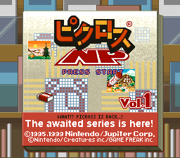
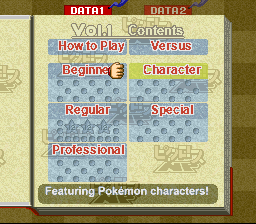
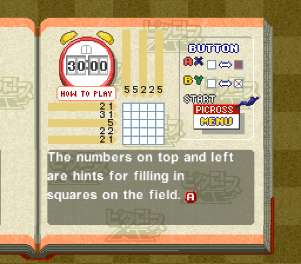
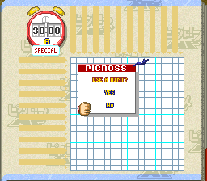
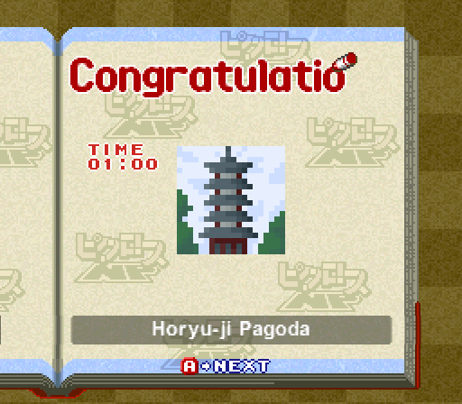
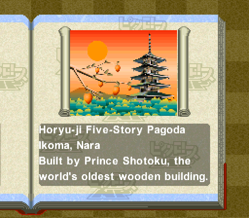

# Picross NP Repuzzled

English translations of the eight **Picross NP** (Nintendo Power) Super Famicom games, built with an
open-source, AI-assisted toolchain. Each volume is a patch for the original Japanese ROM; no ROM data is
included in this repository.

| Volume | Status | Patch |
|---|---|---|
| Picross NP Vol. 1 | ✅ Complete | [`patches/Picross_NP_Vol1_English.bps`](patches/) |
| Picross NP Vol. 2 | ✅ Complete | [`patches/Picross_NP_Vol2_English.bps`](patches/) |
| Picross NP Vol. 3 | ✅ Complete | [`patches/Picross_NP_Vol3_English.bps`](patches/) |
| Picross NP Vol. 4 | ✅ Complete | [`patches/Picross_NP_Vol4_English.bps`](patches/) |
| Picross NP Vol. 5 | ✅ Complete | [`patches/Picross_NP_Vol5_English.bps`](patches/) |
| Picross NP Vol. 6 | ✅ Complete | [`patches/Picross_NP_Vol6_English.bps`](patches/) |
| Picross NP Vol. 7 | ✅ Complete | [`patches/Picross_NP_Vol7_English.bps`](patches/) |
| Picross NP Vol. 8 | ✅ Complete | [`patches/Picross_NP_Vol8_English.bps`](patches/) |

## Screenshots (Vol. 1)

<table>
<tr>
<td></td>
<td></td>
</tr>
<tr>
<td></td>
<td></td>
</tr>
<tr>
<td></td>
<td></td>
</tr>
</table>

## Applying a patch

Use any BPS patcher (e.g. [Floating IPS](https://www.smwcentral.net/?p=section&a=details&id=11474),
[Rom Patcher JS](https://www.marcrobledo.com/RomPatcher.js/), or `python tools/bps.py apply ROM PATCH OUT`).

**Vol. 1** — source ROM (No-Intro): `Picross NP Vol. 1 (Japan) (Rev 1) (NP).sfc`
* size 1,048,576 bytes, no copier header
* CRC32 `E6F29429`, SHA-1 `75b2b639e73775f1709059a8b1b63f61983de0e8`
* patched result: CRC32 `4A55D609`, SHA-1 `384f4e269bc23d66fda9baa44f1f4620b4ec17a4`

**Vol. 2** — source ROM (No-Intro): `Picross NP Vol. 2 (Japan) (Rev 1) (NP).sfc`
* size 1,048,576 bytes, no copier header
* CRC32 `1DF8A75C`, SHA-1 `dbad4ed4f1c4bb54bf44223833c056179c4cc4f2`
* patched result: CRC32 `366B5DB9`, SHA-1 `ee817390a8778ce1c6cc4c1d230477c860e25460`

**Vol. 3** — source ROM (No-Intro): `Picross NP Vol. 3 (Japan) (Rev 1) (NP).sfc`
* size 1,048,576 bytes, no copier header
* CRC32 `717243E7`, SHA-1 `456d8a187edd2f35731f58656b94fcaf65daae40`
* patched result: CRC32 `102C3282`, SHA-1 `add9f305b3f9c50aa4086f46d0e8652329ea06bd`

**Vol. 4** — source ROM (No-Intro): `Picross NP Vol. 4 (Japan) (Rev 1) (NP).sfc`
* size 1,048,576 bytes, no copier header
* CRC32 `696778FA`, SHA-1 `2239de70d257f0d66d21dddd716d3cc9413523ee`
* patched result: CRC32 `14A3E8FD`, SHA-1 `6b407df0828acea547f63afb05350cec23efed52`

**Vol. 5** — source ROM (No-Intro): `Picross NP Vol. 5 (Japan) (Rev 1) (NP).sfc`
* size 1,048,576 bytes, no copier header
* CRC32 `5AC117C9`, SHA-1 `4f7c151ee6d3e0735dbe55d4958942aa9003909c`
* patched result: CRC32 `B57E6570`, SHA-1 `a73ae1b84527175ec6178785515fd79041160cfa`

**Vol. 6** — source ROM (No-Intro): `Picross NP Vol. 6 (Japan) (Rev 1) (NP).sfc`
* size 1,572,864 bytes, no copier header
* CRC32 `B1D6A070`, SHA-1 `a13cf604a0667541d7fbb8e139f808dfc83dbb07`
* patched result: CRC32 `2514B899`, SHA-1 `9a93a032f4c51f652b79ca2f296717de038aa9f3`

**Vol. 7** — source ROM (No-Intro): `Picross NP Vol. 7 (Japan) (Rev 1) (NP).sfc`
* size 1,572,864 bytes, no copier header
* CRC32 `2528D5A0`, SHA-1 `8870889c042b21d2a5a1fc2fed4dc8803d829b0b`
* patched result: CRC32 `1A6F7371`, SHA-1 `2efcfc9d2fb60d4ae1bc323317029e5de092da5d`

**Vol. 8** — source ROM (No-Intro): `Picross NP Vol. 8 (Japan) (Rev 1) (NP).sfc`
* size 1,572,864 bytes, no copier header
* CRC32 `2FBEEA6E`, SHA-1 `b34537a0efdae9cf25eab0e3c4f4dd802a98a63b`
* patched result: CRC32 `076C20E8`, SHA-1 `eac3a6130858132c993e129bfa6736d945add97a`

Releases are numbered for the whole project: each GitHub release contains the current patch for every
finished volume.

## What's translated (Vol. 1)

Everything Japanese in the game, verified screen by screen in an emulator:

* Title tagline, save-file panels (New Game / Continue / Copy / Erase), main menu, help lines, CLEAR stamps, menu tabs
* All 122 puzzle names (checked against each puzzle's solution picture), puzzle-select and in-game mode labels
* In-game windows: hint prompt, pause menu, Give Up / Save / BGM / Stereo / ? Start / Confirm, "Saved!"
* The complete How to Play tutorial (Basic Rules, Handy Features, ? Start, 2-Player, Versus)
* Special (特集) landmark descriptions, the prize-contest screen (address card, deadline, rules)
* Bonus certificate (text, rank titles, seals), staff credits, "more volumes coming" footer
* Save-data warning messages

The stylised ピクロス logo artwork is left as is.

**Vol. 2** has the same coverage: all 122 puzzle names (including the Yoshi's Island characters in
Character mode, with their official English names), the tutorial, the new "Ready?" window
(Start / Use a Hint / Cancel), the Versus round picker, the prize contest, certificate and credits.

**Vol. 3** has the same coverage, with Kirby characters in Character mode (official English names).

**Vol. 4** has the same coverage, with the Star Fox 64 cast in Character mode (official English names).

**Vol. 5** has the same coverage, with The Legend of Zelda: Ocarina of Time characters in Character mode
(official English names).

**Vol. 6–8** (the 2000 "renewal" issues, 242 puzzles each: 122 new ones plus a 120-puzzle selection from Vols. 1–5
that unlocks after clearing everything) have the same coverage, plus the new Logic / Hunch Versus modes and the
gift-puzzle message. Character mode: Super Mario 64 (Vol. 6), Wario Land II (Vol. 7; most of its enemies never got
official English names, so the MarioWiki or romanised names are used), Donkey Kong (Vol. 8).

## Building from source

Requirements: Python 3.10+, `pip install pillow numpy`, and the fonts Arial Bold, Arial Narrow Bold and
Verdana Bold (standard on Windows; elsewhere set `PICROSS_FONT_DIR`).

```
python vol1/build.py "path/to/Picross NP Vol. 1 (Japan) (Rev 1) (NP).sfc"
python vol2/build.py "path/to/Picross NP Vol. 2 (Japan) (Rev 1) (NP).sfc"
python vol3/build.py "path/to/Picross NP Vol. 3 (Japan) (Rev 1) (NP).sfc"
python vol4/build.py "path/to/Picross NP Vol. 4 (Japan) (Rev 1) (NP).sfc"
python vol5/build.py "path/to/Picross NP Vol. 5 (Japan) (Rev 1) (NP).sfc"
python vol6/build.py "path/to/Picross NP Vol. 6 (Japan) (Rev 1) (NP).sfc"   # likewise vol7, vol8
```

Output goes to `volN/out/` (`.sfc`, `.bps`, `.ips`). Translations live in plain-text tables in `volN/script/`
(`*.tsv`: id, Japanese, English) — edit them and rebuild. The build warns if a line is too wide for its box.

## Repository layout

| Path | Contents |
|---|---|
| `tools/` | Shared engine tools: LZ codec, variable-width font, metasprites, tile/label renderers, BPS, emulator driver, auto-solver, save generator, disassembler |
| `vol1/` … `vol8/` | Per-volume addresses (`volume.py`), translation tables (`script/`), notes |
| `docs/METHOD.md` | Step-by-step method for translating the other volumes with these tools |
| `patches/` | Released patches |

## Credits

* Translation and hacking: jakequi, AI-assisted (Claude)
* Original game: Nintendo / Jupiter, 1995–1999; Pokémon puzzles © Nintendo / Creatures / GAME FREAK

This is an unofficial fan translation, not affiliated with or endorsed by Nintendo.

## License

The tools, build scripts and translation tables are released under the MIT License (see `LICENSE`).
